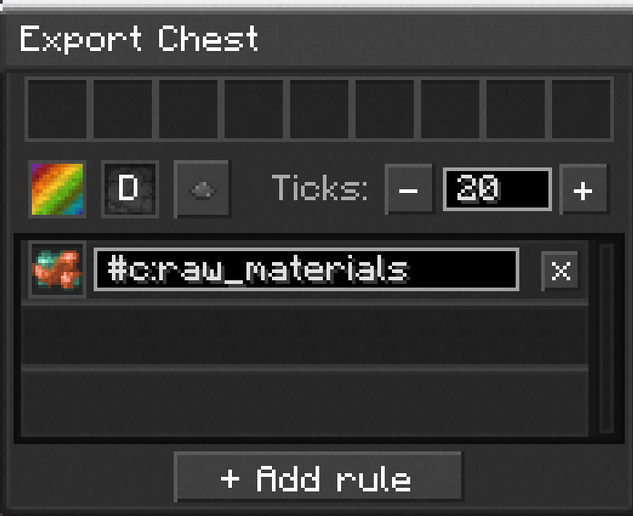
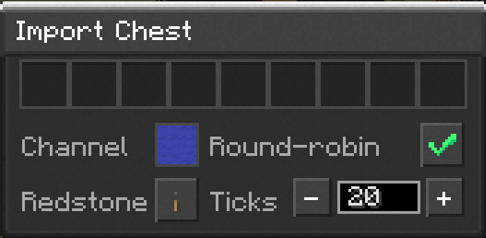
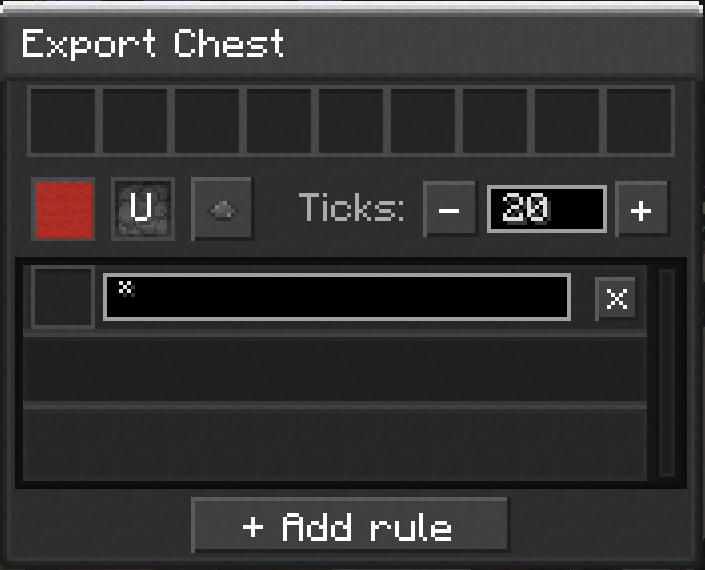
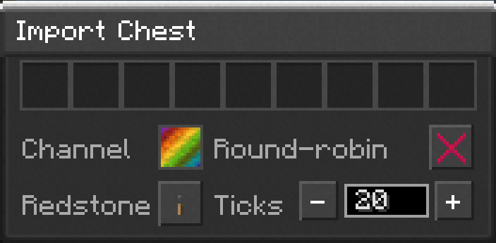

---
navigation:
  parent: example-setups/index.md
  icon: minecraft:furnace
  title: Automated Smelting Subnet
categories:
  - example
---

# Automated Smelting Subnet

You can bridge two networks together using a <ItemLink id="export_chest" /> and an <ItemLink id="import_chest" />. This example shows a network pushing its `#c:raw_material` items to a smaller network with an array of furnaces. That smaller network then pushes its cooked results back
to the original network.

<GameScene zoom="4" interactive={true} paddingLeft="30" paddingRight="30">
  <ImportStructure src="../assets/assemblies/automated_smelting.snbt" />
  <IsometricCamera yaw="190" pitch="10" />
  <BlockAnnotation x="7" y="4">
  
  </BlockAnnotation>
  <BlockAnnotation x="7" y="3">
  
  </BlockAnnotation>
  <BlockAnnotation x="5" y="3">
  
  </BlockAnnotation>
  <BlockAnnotation x="5" y="4">
  
  </BlockAnnotation>
  <DiamondAnnotation pos="7.5 4 0.5" color="#ff0000">
    Export Chest from the storage Network has items pushing Down set in its GUI.

    **These two chests don't connect to each other, they're part of two separate
    networks.**
  </DiamondAnnotation>
  <DiamondAnnotation pos="5.5 4 0.5" color="#ff0000">
    Export Chest from the furnace Network is pushing its items Up which is set in its GUI.

    **These two chests don't connect to each other, they're part of two separate
    networks.**
  </DiamondAnnotation>
  <BoxAnnotation min="5 0.75 0" max="8 1 1" color="#B02E26">
    <ItemImage id="storage_card" /> Storage Cards set to the Red Channel are being pulled from by the Export Chest using the filter `*` to grab everything
  </BoxAnnotation>
  <BoxAnnotation min="5 2 0" max="8 2.25 1" color="#3C44AA">
    <ItemImage id="storage_card" /> Storage Cards set to the Blue Channel is where the Import Chest is pushing items to using round-robin
  </BoxAnnotation>
</GameScene>

Optionally you can use <ItemLink id="transfer_card" />s with barrels to achieve the same thing in less space.

<GameScene zoom="4" interactive={true} paddingLeft="30" paddingRight="30">
  <ImportStructure src="../assets/assemblies/automated_smelting_no_chests.snbt" />
  <IsometricCamera yaw="190" pitch="10" />
  <DiamondAnnotation pos="7.5 4 0.5" color="#ff8800">
    <ItemImage id="transfer_card" /> Transfer Card set to **export** from the storage Network into the barrel.

    Rules:
    > `#c:raw_materials`
  </DiamondAnnotation>
  <DiamondAnnotation pos="7.5 3 0.5" color="#5555ff">
    <ItemImage id="transfer_card" /> Transfer Card set to **import** from the barrel into <Color color="#5555ff">blue storage cards.</Color>
  </DiamondAnnotation>
  <DiamondAnnotation pos="5.5 4 0.5" color="#5555ff">
    <ItemImage id="transfer_card" /> Transfer Card set to **import** into the storage network from the barrel.
  </DiamondAnnotation>
  <DiamondAnnotation pos="5.5 3 0.5" color="#ff8800">
    <ItemImage id="transfer_card" /> Transfer Card set to **export** from <Color color="#ff2222">red storage cards</Color> into the barrel.
  </DiamondAnnotation>
  <BoxAnnotation min="5 0.75 0" max="8 1 1" color="#B02E26">
    <ItemImage id="storage_card" /> Storage Cards set to the Red Channel
  </BoxAnnotation>
  <BoxAnnotation min="5 2 0" max="8 2.25 1" color="#3C44AA">
    <ItemImage id="storage_card" /> Storage Cards set to the Blue Channel
  </BoxAnnotation>
</GameScene>
