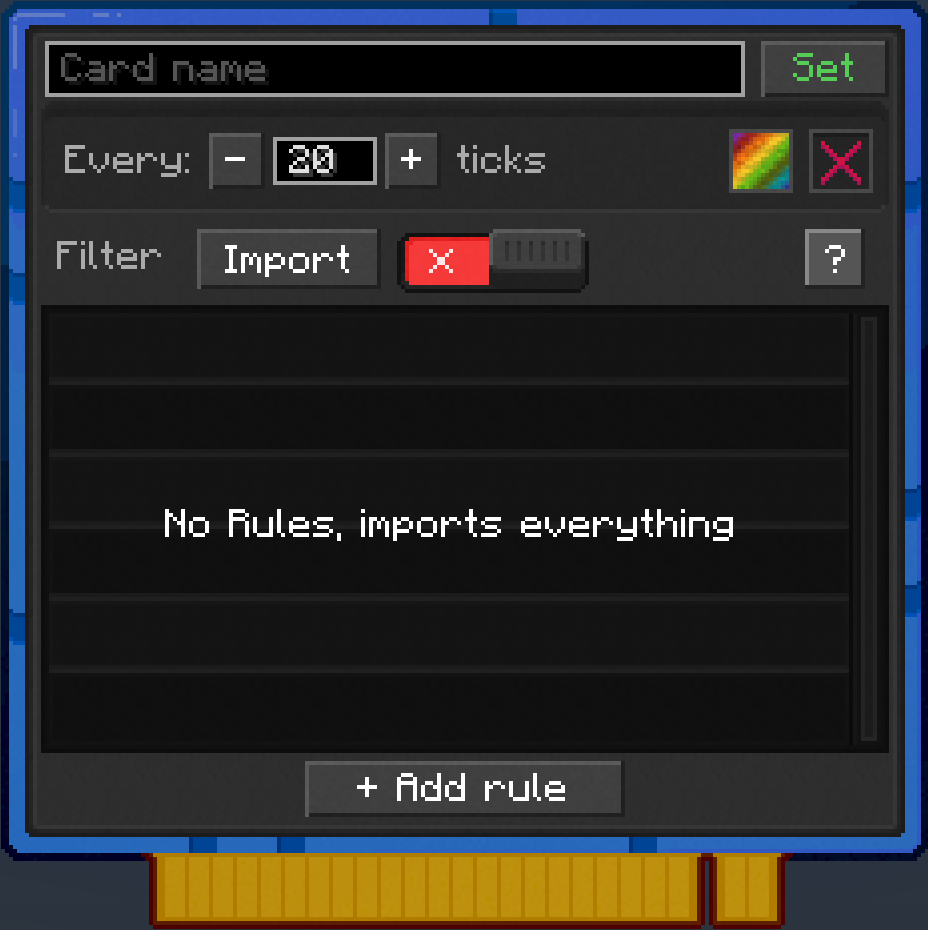
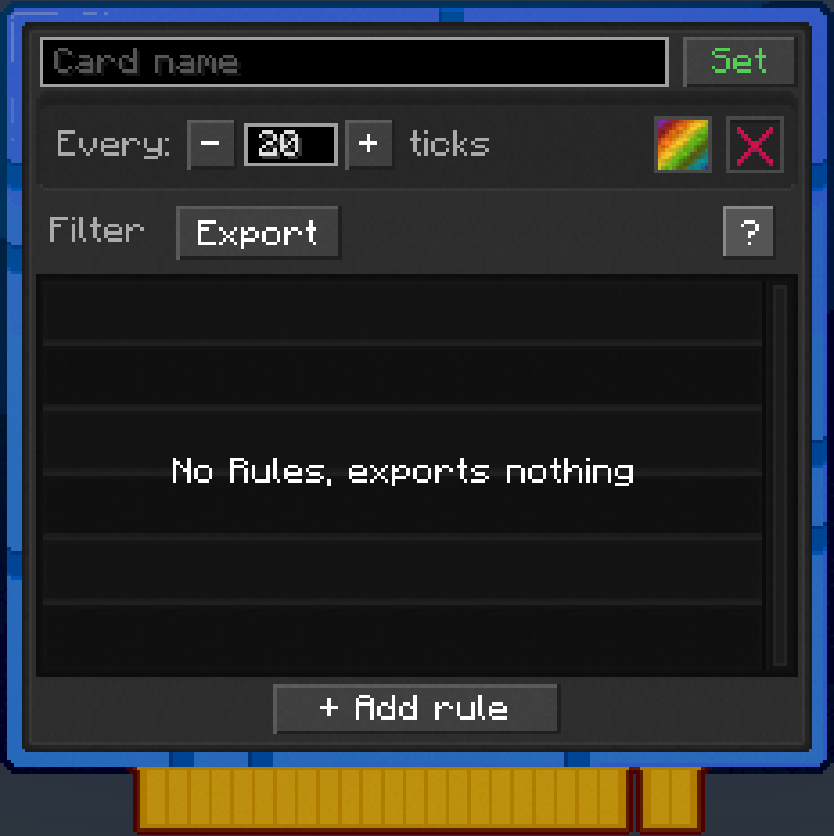

---
navigation:
  parent: items-blocks/index.md
  icon: transfer_card
  title: Transfer Card
categories:
  - card
description: moves items between the adjacent block and network storage
item_ids:
- nodeworks:transfer_card
---

# Transfer Card

A Transfer Card moves items between the adjacent block and
[Network Storage](../nodeworks-mechanics/network-storage.md) on its own, no
script needed. Point it at a chest and pick a direction: **Import** empties the
chest into the network, **Export** fills the chest from the network.

<ItemImage scale="6" id="transfer_card" />

It is the quickest way to move items between two chests. Put a Transfer Card on
one, a <ItemLink id="storage_card" /> on the other, and the first chest drains
into the second. No <ItemLink id="network_controller" /> is required.

## Installing

Transfer Cards go in the face slots of a <ItemLink id="node" />, the same as a
<ItemLink id="storage_card" />. Right-click the face of the node touching the
block you want to move items to or from and drop the card into any of the 9
slots. The card draws a blue beam to the block it is working with.

## Configuration

Right-click with the card in hand to open its settings.

 

### Import and Export

The button at the top of the filter section switches the mode:

- **Import**: items in the adjacent block are moved into the network's Storage
  Cards. With no rules, everything moves.
- **Export**: items matching the rules are pulled out of Storage Cards into the
  adjacent block. With no rules, nothing moves, so a fresh card never drains your
  network.

Switching modes keeps your rules, so you can flip a card back and forth without
retyping them.

### Rules

Rules use the same syntax as the <ItemLink id="storage_card" />, and you add
them the same way: click **[+ Add Rule]** and type, or drag an item from JEI
onto the list. See [Storage Card filters](./storage_card.md#rules) for the full
syntax. A Transfer Card has no Allow or Deny mode, its rules always say which
items to move.

> Storage Cards keep their own filters. An importing Transfer Card only puts
items where the receiving Storage Card accepts them.

### Round robin

In Import mode, turning on **Round robin** spreads items across your Storage
Cards instead of filling the highest priority one first. Each run starts with a
different card.

### Speed

**Every** sets how many ticks pass between runs, from 1 to 600. The default of
20 is once a second. Each run moves up to nine stacks, so a faster card moves
more per second, up to the network's limits.

### Channel

The channel picker chooses which Storage Cards the card trades with. With no
channel set, the default, it uses every Storage Card on the network. Pick a
colour to only import into, or only export from, Storage Cards of that colour.
See [Choosing a Channel](../lua-api/channel.md#choosing-a-channel).

### Target face

Like the Storage Card, you can pick which face of the adjacent block the card
uses. Leave it on the default unless the block has side-specific slots, like a
furnace.

## Sorting a chest in place

A Transfer Card and a Storage Card can share the same face of a node. The
Transfer Card ignores the Storage Card next to it, so it never moves items back
into the chest they came from.

This is handy for sorting. Put an Import card with the rule `#c:armors` on your
general chest, and a Storage Card on an armour chest elsewhere. Every piece of
armour in the general chest walks over to the armour chest, and everything else
stays where it is.

## The difference from Import and Export Chests

The <ItemLink id="import_chest" /> and <ItemLink id="export_chest" /> are
blocks with their own 9-slot buffer, and they add things a card does not have:
a push face, redstone control, and wireless transfer through antennas. A
Transfer Card works directly on an existing block with no buffer in between,
and is the cheaper, smaller option when all you want is to move items.

> **Tip:** Use a <ItemLink id="card_programmer" /> to copy a Transfer Card's
> mode, rules, round robin and speed onto other cards.

## Recipe

<RecipeFor id="transfer_card" />
